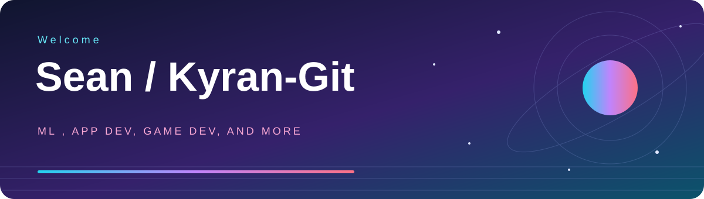

# Hi, I'm Sean

### Exploring ideas. Building across platforms. Learning by shipping.

From astronomy in Minecraft to neural networks and cross-platform apps, 
this is where curiosity becomes code.

  
  

<a href="#the-project-showcase">Projects</a> &nbsp; / &nbsp;
<a href="#my-toolbox">Toolbox</a> &nbsp; / &nbsp;
<a href="#the-rest-of-the-workshop">More to explore</a> &nbsp; / &nbsp;
<a href="#lets-connect">Connect</a>

---

## A little about me

I like building practical projects, exploring unfamiliar tools, and turning what I learn into something useful. My repositories span **AI, educational experiences, web systems, desktop apps, and game development** rather than a single stack.

- **Learning through exploration:** bringing astronomy into Minecraft with Solaria.
- **Experimenting with AI:** car-type recognition and AI-powered quiz generation.
- **Building useful systems:** mentorship software and desktop-to-API integration.
- **Keeping the knowledge:** collecting computer science notes alongside the code.

> Different platforms. Different problems. The same drive to keep building and improving.

## The project showcase

<table>
<tr>
<td width="50%" valign="top">
  <h3><a href="https://github.com/Kyran-Git/Solaria">Solaria</a></h3>
  
<strong>A little more universe. A lot more discovery.</strong>

  
A Minecraft mod aimed at helping students learn astronomy through personal exploration. The repository brings together SolariaMC, SolariaAI, and documentation.

  
 

  <a href="https://github.com/Kyran-Git/Solaria">Explore Solaria &rarr;</a>
</td>
<td width="50%" valign="top">
  <h3><a href="https://github.com/Kyran-Git/CarTypeRecognizer">CarTypeRecognizer</a></h3>
  
<strong>Teaching a neural network to tell cars apart.</strong>

  
An IRSS team project focused on recognizing car types with a neural network. A Python-based exploration of machine learning and visual recognition.

  
 

  <a href="https://github.com/Kyran-Git/CarTypeRecognizer">Explore the recognizer &rarr;</a>
</td>
</tr>
<tr>
<td width="50%" valign="top">
  <h3><a href="https://github.com/Kyran-Git/AIQuizGenerator">AIQuizGenerator</a></h3>
  
<strong>AI meets the study session.</strong>

  
A Flutter application for AI quiz generation, with Dart app code and Python backend scripts. Includes UI and controllers for authentication, AI, and exam flows.

  
 

  <a href="https://github.com/Kyran-Git/AIQuizGenerator">Explore the quiz app &rarr;</a>
</td>
<td width="50%" valign="top">
  <h3><a href="https://github.com/Kyran-Git/IRSS-Mentors">IRSS-Mentors</a></h3>
  
<strong>Software built around mentorship.</strong>

  
A mentorship system built using Java EE technology, with Java source, web resources, and an Ant build configuration.

  
 

  <a href="https://github.com/Kyran-Git/IRSS-Mentors">Explore the mentorship system &rarr;</a>
</td>
</tr>
<tr>
<td width="50%" valign="top">
  <h3><a href="https://github.com/Kyran-Git/MagusEscape">MagusEscape</a></h3>
  
<strong>A detour into game development.</strong>

  
A Unity project with game assets, packages, and project settings. Another side of the workshop: experimenting beyond traditional applications.

  
 

  <a href="https://github.com/Kyran-Git/MagusEscape">Explore MagusEscape &rarr;</a>
</td>
<td width="50%" valign="top">
  <h3><a href="https://github.com/Kyran-Git/WPF-API">WPF-API</a></h3>
  
<strong>Connecting desktop interfaces to custom APIs.</strong>

  
A C# project exploring how a WPF application connects to a custom API, with separate API and WPF folders in one solution.

  
 

  <a href="https://github.com/Kyran-Git/WPF-API">Explore the desktop connection &rarr;</a>
</td>
</tr>
</table>

## My toolbox

Technologies represented across my public repositories. Different tools for different ideas.

### Languages

  
  
  
  
  
  
  

### Platforms &amp; creative tools

  
  
  
  
  
  

## The rest of the workshop

<strong>Open the drawers: more apps, experiments, and coursework</strong>

| Repository | Inside the workshop |
| :--- | :--- |
| [barbershop](https://github.com/Kyran-Git/barbershop) | JavaScript project described as a “530 project.” |
| [Inventory-System](https://github.com/Kyran-Git/Inventory-System) | PHP repository for an inventory-system project. |
| [InternWPF](https://github.com/Kyran-Git/InternWPF) | More C# work in the WPF corner. |
| [collab](https://github.com/Kyran-Git/collab) | A two-developer collaboration, with CSS as its primary language. |
| [508Individual](https://github.com/Kyran-Git/508Individual) | Java repository. |
| [CSC557-Assignment-2](https://github.com/Kyran-Git/CSC557-Assignment-2) | Java assignment repository. |
| [IndividualAssignmentCSC584](https://github.com/Kyran-Git/IndividualAssignmentCSC584) | Individual Java assignment repository. |

<strong>Open the notebook: computer science notes</strong>

[Notes](https://github.com/Kyran-Git/Notes) is my collection of Markdown notes on computer science and related subjects. A place to keep the learning, not just the finished code.

## What keeps me building

| Explore | Build | Improve |
| :--- | :--- | :--- |
| New tools, unfamiliar platforms, and ideas worth testing. | Useful software, interactive experiences, and team projects. | Clean code, maintainability, and engineering skills through practice. |

---

## Let's connect

**Interested in the projects, the process, or what comes next?**

[Find me on LinkedIn](https://www.linkedin.com/in/sean-mikhail-6759bb444/?isSelfProfile=true) &nbsp; / &nbsp; [Explore all repositories](https://github.com/Kyran-Git?tab=repositories)

Built with curiosity. Improved with practice. Always another idea to explore.

